  

  

# 🎬 Awesome Text-To-Video & Automated Briefing Generation 🚀

**Curated Landscape of Enterprise SaaS Leaders, Open-Weight Foundation Models & Audio-Driven Avatar Engines**  
*Transforming scripts, articles, URLs, slides, and datasets into cinematic briefings and photorealistic talking-head video presentations.*

**Last updated: November 2026**

---

## 📌 Table of Contents

- [🌐 Sector Overview & Market Dynamics](#-sector-overview--market-dynamics)
- [🏢 SaaS & Hosted Platforms](#-saashosted-platforms)
- [💻 Open-Source GitHub Projects](#-open-source-github-projects)
- [📈 Star History](#-star-history)
- [💖 Support & Contributing](#-support--contributing)
- [📜 Disclaimer & License](#-disclaimer--license)

---

## 🌐 Sector Overview & Market Dynamics

The global AI video generation and automated briefing market is estimated at **$750 million to $1.2 billion in 2025–2026** and projected to surge past **$3.5 billion by 2030 at a CAGR exceeding 34%**, fueled by enterprise demand for rapid corporate communications, localized training modules, automated news reels, and dynamic social content.

The sector exhibits **moderate fragmentation with distinct tier segmentation**: while foundational generative video models (e.g., Runway, Luma, OpenAI Sora, Wan2.1) compete aggressively on diffusion compute and visual fidelity, enterprise-facing digital human and briefing automation platforms (e.g., Synthesia, HeyGen, Colossyan) build defensible moats through enterprise compliance, high-fidelity lip-sync dubbing, and seamless workflow integrations.

---

## 🏢 SaaS/Hosted Platforms

The table below catalogs premier commercial SaaS solutions for automated video generation, talking-avatar presenter briefings, and text-to-video synthesis, **sorted by valuation / market size (descending)**:

| Platform / Product | Company Size / Valuation | Starting Tier Price | Free Tier / Trial Limits | Key Specialization & Capabilities |
| :--- | :--- | :--- | :--- | :--- |
| **[Runway (Gen-3 / Gen-4)](https://runwayml.com)** | **$3.0 Billion** (Valuation) | **$12 / mo** (Standard plan billed annually) | **Free Forever Plan**: 125 non-renewable one-time credits with 720p output and standard generation speeds | High-fidelity cinematic Text-to-Video diffusion models, Gen-3 Alpha, Act-One facial performance capture, and camera motion directors. |
| **[Synthesia](https://synthesia.io)** | **$1.0 Billion** (Valuation) | **$18 / mo** (Starter plan billed annually) | **Free Forever Plan**: 3 minutes of video generation per month, 6 AI avatars, 36 languages, and watermark | Enterprise corporate video communications, turning docs and slides into studio presenter briefings with 230+ expressive avatars. |
| **[HeyGen](https://heygen.com)** | **$500 Million** (Valuation) | **$24 / mo** (Creator plan billed annually) | **Free Forever Plan**: 1 free credit (1 min video), 720p resolution, access to 300+ avatars, and hosted sharing link | Hyper-realistic digital twins, instant highlights, streaming avatars, and voice-cloned lip-sync dubbing across 175+ languages. |
| **[Luma AI (Dream Machine)](https://lumalabs.ai)** | **$300 Million** (Valuation) | **$7.99 / mo** (Lite plan billed annually) | **Free Forever Plan**: 30 generations per month, standard queue priority, and non-commercial license | High-motion multimodal Text-to-Video and Image-to-Video foundation models producing coherent physical interactions and camera sweeps. |
| **[Pika Labs (Pika)](https://pika.art)** | **$250 Million** (Valuation) | **$8 / mo** (Standard plan billed annually) | **Free Forever Plan**: 150 non-replenishing credits on sign-up + 30 daily credits thereafter with watermark | Creative text-to-video synthesis featuring Pikascenes, lip-syncing, audio effects generation, dynamic physics, and canvas expansion. |
| **[Colossyan](https://colossyan.com)** | **$150 Million** (Valuation) | **$19 / mo** (Starter plan billed annually) | **14-Day Free Trial**: 5 minutes of total video generation with full access to standard avatars and scenario builders | AI video creator tailored for workplace learning, compliance, converting PDFs/PPTs into multi-avatar briefings with branching quizzes. |
| **[D-ID](https://d-id.com)** | **$120 Million** (Valuation) | **$4.70 / mo** (Lite plan billed annually) | **14-Day Free Trial**: 5 minutes (20 credits) of video creation with watermark and access to basic presenter heads | Creative Reality Studio animating still portrait images and photos into talking avatars from audio/text streams in real time. |
| **[DeepBrain AI (AI Studios)](https://deepbrain.io)** | **$100 Million** (Valuation) | **$24 / mo** (Starter plan billed annually) | **Free Forever Plan**: 1 minute video per month, 1 AI avatar, basic text-to-speech voices, and watermark | Cloud text-to-video and virtual newsroom platform transforming URLs, docs, and scripts into broadcast-ready AI news anchor briefings. |
| **[InVideo AI](https://invideo.io)** | **$80 Million** (Valuation) | **$20 / mo** (Plus plan billed annually) | **Free Forever Plan**: 10 minutes/week of AI generation, 4 exports/week with InVideo watermark, and 10GB storage | End-to-end prompt-to-video studio generating complete narrated scripts, stock B-roll matching, human-like voiceovers, and subtitles. |
| **[Pictory](https://pictory.ai)** | **$50 Million** (Valuation) | **$19 / mo** (Standard plan billed annually) | **14-Day Free Trial**: 3 video projects up to 10 minutes each with standard stock assets and watermark | AI video engine converting long-form articles, whitepapers, blog posts, and audio transcripts into bite-sized summary video digests. |
| **[Hour One](https://hourone.ai)** | **$45 Million** (Valuation) | **$25 / mo** (Lite plan billed annually) | **Free Forever Plan**: 3 minutes of published video per month with standard templates, basic avatars, and watermark | Enterprise briefing automation platform creating recurring corporate announcements, training, and news recaps via photorealistic avatars. |
| **[Elai.io (Panopto)](https://elai.io)** | **$30 Million** (Valuation) | **$23 / mo** (Basic plan billed annually) | **Free Forever Plan**: 1 minute of video credit total, 80+ avatars, and basic automated text/URL translation | Script/URL/PPTX to video converter with customized digital presenters and multi-speaker voice synthesis for corporate communication. |

---

## 💻 Open-Source GitHub Projects

Explore the open-source ecosystem powering modern text-to-video foundation models, audio-driven talking-head avatars, lip-sync algorithms, and programmatic video assemblers. 

The list below is **sorted by GitHub Stargazers count (descending)**:

1. **[ComfyUI](https://github.com/Comfy-Org/ComfyUI)**   
   The premier modular node-graph GUI, API, and backend for diffusion models, orchestrating complex multi-stage Text-to-Video and talking-head pipelines on local and cloud GPUs.

2. **[MoneyPrinterTurbo](https://github.com/harry0703/MoneyPrinterTurbo)**   
   Fully automated one-click short video generator that takes a prompt, writes narration via LLMs, sources HD video B-roll, synthesizes voiceovers, and compiles styled subtitle overlays.

3. **[Remotion](https://github.com/remotion-dev/remotion)**   
   Industry-standard framework for programmatically generating automated data-driven video briefings, dynamic charts, motion graphics, and news reels in React and TypeScript.

4. **[Open-Sora](https://github.com/hpcaitech/Open-Sora)**   
   Colossal-AI's open-source initiative democratizing efficient text-to-video generation with accessible model weights, training scripts, dynamic spatial-temporal DiT architectures, and scalable inference.

5. **[Generative Models (Stable Video Diffusion)](https://github.com/Stability-AI/generative-models)**   
   Stability AI's official open foundation model repository featuring Stable Video Diffusion (SVD/SVD-XT) for high-resolution video frame generation and camera manipulation.

6. **[LivePortrait](https://github.com/KlingAIResearch/LivePortrait)**   
   Fast, controllable portrait animation and facial retargeting engine from Kling AI Research delivering realistic presenter expressions, head pose, and eye gaze tracking.

7. **[Wan2.1](https://github.com/Wan-Video/Wan2.1)**   
   Alibaba's advanced open-weight video foundation model suite (`T2V-14B` and `T2V-1.3B`) offering exceptional Text-to-Video visual aesthetics, multilingual text rendering, and consumer-GPU compatibility.

8. **[MoviePy](https://github.com/Zulko/moviepy)**   
   Popular open-source Python library for programmatic video editing, concatenating slide briefings, compositing talking-head overlays, audio mixing, and automated rendering.

9. **[AnimateAnyone](https://github.com/HumanAIGC/AnimateAnyone)**   
   Controllable character animation framework utilizing ReferenceNet and spatial-temporal attention to turn static full-body or portrait images into seamlessly animated briefing hosts.

10. **[SadTalker](https://github.com/OpenTalker/SadTalker)**   
    Foundational audio-driven talking-face animator synthesizing realistic 3D motion coefficients, head tilts, and lip synchronization from a single portrait photo and audio track.

11. **[Fay](https://github.com/xszyou/Fay)**   
    Open-source digital human agent framework connecting LLMs, speech recognition (ASR), voice synthesis (TTS), and 2D/3D avatar engines for automated livestreaming and interactive briefings.

12. **[Wav2Lip](https://github.com/Rudrabha/Wav2Lip)**   
    State-of-the-art phoneme-accurate lip-sync model capable of seamlessly synchronizing target speech audio to arbitrary speaking video footage and briefing presentations.

13. **[CogVideoX](https://github.com/zai-org/CogVideo)**   
    Tsinghua & Zhipu AI's flagship diffusion transformer model family (`CogVideoX-2B`, `CogVideoX-5B`) with 3D causal VAE compression, commercial licenses, and fine-tuning support.

14. **[HunyuanVideo](https://github.com/Tencent-Hunyuan/HunyuanVideo)**   
    Tencent's 13B-parameter open-weight Text-to-Video diffusion transformer achieving cinema-grade scene generation, accurate prompt following, and comprehensive modularity.

15. **[Open-Sora-Plan](https://github.com/PKU-YuanGroup/Open-Sora-Plan)**   
    PKU-Yuan Group's open reproduction and architectural enhancement of OpenAI Sora with dynamic video latent diffusion transformers, 3D VAEs, and complete weights.

16. **[NarratoAI](https://github.com/linyqh/NarratoAI)**   
    AI-powered automated video commentary and editing pipeline combining visual LLMs, automatic narrative scripting, voiceovers, and FFmpeg assembly into cohesive briefings.

17. **[LTX-Video](https://github.com/Lightricks/LTX-Video)**   
    Real-time open DiT video model by Lightricks producing high-definition 30 FPS video clips faster than real-time playback on consumer-tier GPUs.

18. **[Hallo](https://github.com/fudan-generative-vision/hallo)**   
    Hierarchical audio-driven portrait animation framework generating realistic, expressive talking avatars with natural eye blinks and head motion dynamics.

19. **[ShortGPT](https://github.com/RayVentura/ShortGPT)**   
    Experimental automation engine for content creators that automates video synthesis, multilingual voiceovers, asset extraction, and formatted caption styling.

20. **[SkyReels-V2](https://github.com/SkyworkAI/SkyReels-V2)**   
    Infinite-length cinematic film and automated briefing generative model utilizing Diffusion Forcing and autoregressive extension to generate long-sequence coherent videos.

21. **[Video-ReTalker](https://github.com/OpenTalker/video-retalking)**   
    Audio-driven video retalking system from OpenTalker that modifies lip motion in existing video footage to match arbitrary new audio tracks with high fidelity.

22. **[ProPainter](https://github.com/sczhou/ProPainter)**   
    Dual-domain video inpainting and dynamic completion framework ideal for removing unwanted artifacts, watermarks, and refining briefing scenes.

23. **[MuseTalk](https://github.com/TMElyralab/MuseTalk)**   
    Tencent Music's real-time (30+ FPS) latent-space lip-synchronization model supporting multi-language dubbing and avatar broadcasting over input videos.

24. **[LatentSync](https://github.com/bytedance/LatentSync)**   
    ByteDance's end-to-end lip-sync framework built directly on Stable Diffusion latent space with temporal continuity for photorealistic avatar briefings.

25. **[EchoMimicV2](https://github.com/antgroup/echomimic_v2)**   
    Ant Group's semi-body human animation framework synthesizing coordinated hand gestures, natural facial expressions, and synced lips from audio speech.

26. **[Mochi 1](https://github.com/genmoai/mochi)**   
    Apache 2.0 10B-parameter Asymmetric Diffusion Transformer (AsymmDiT) by Genmo delivering state-of-the-art fluid visual motion and prompt adherence.

27. **[Hallo2](https://github.com/fudan-generative-vision/hallo2)**   
    Long-duration and 4K high-resolution audio-driven portrait animation model equipped with expressive non-verbal gestures and emotional facial dynamics.

28. **[Linly-Talker](https://github.com/Kedreamix/Linly-Talker)**   
    Conversational digital avatar system orchestrating Whisper speech recognition, LLM dialog reasoning, Edge-TTS/CosyVoice, and SadTalker into an integrated WebUI.

29. **[VGen](https://github.com/ali-vilab/VGen)**   
    Alibaba video generation codebase featuring I2VGen-XL, VideoComposer, and text-to-video foundation models with high visual aesthetic quality.

30. **[Brief2MP4](https://github.com/qualixar/brief2mp4)**   
    Open-source automated briefing-to-video generator converting structured briefs, scripts, and documents into checked MP4 video summaries across 30+ visual styles.

---

## 📈 Star History

## Star History

---

## 💖 Support & Contributing

Contributions are warmly welcome! If you'd like to add a new open-source model, update SaaS pricing metrics, or expand capabilities:
1. 🍴 **Fork** this repository
2. 🌿 Create your feature branch (`git checkout -b feature/awesome-addition`)
3. 💾 Commit your changes (`git commit -m 'Add new open-source video model'`)
4. 🚀 Push to the branch (`git push origin feature/awesome-addition`)
5. 📬 Open a **Pull Request**

### 🙏 Support the Project
If this repository saved you time, broadened your AI video tooling horizon, or helped your research, please consider:
- ⭐ **Starring** this repository to help others discover it!
- 📢 Sharing it with colleagues, developers, and AI communities.
- ☕ Buying a coffee to support maintenance on the [GitHub Sponsors Dashboard](https://github.com/sponsors/ishandutta2007)!

---

## 📜 Disclaimer & License

This project is licensed under the MIT License. Trademarks and product names belong to their respective owners and are mentioned purely for educational and comparative cataloging purposes.
